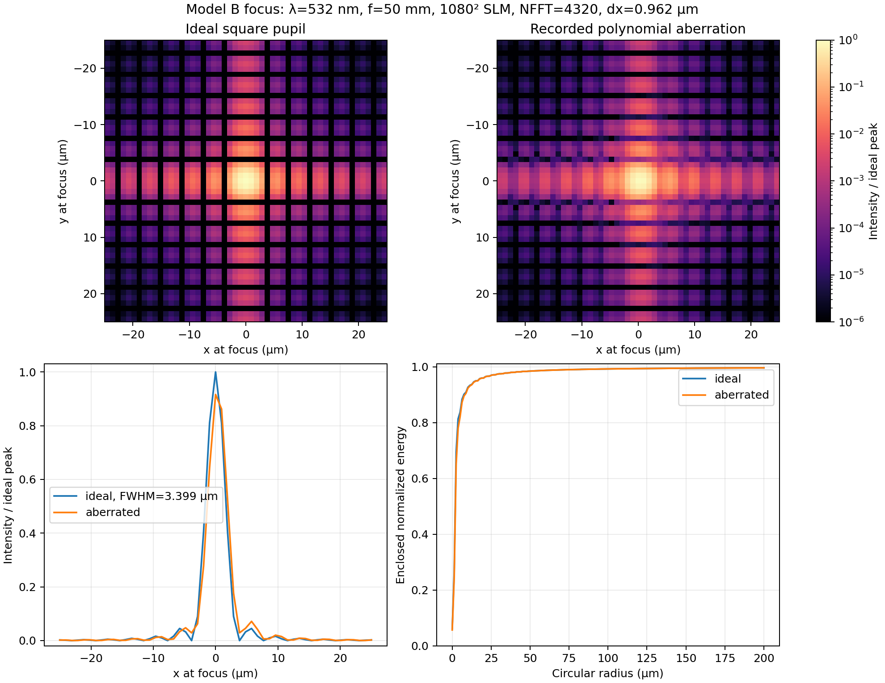
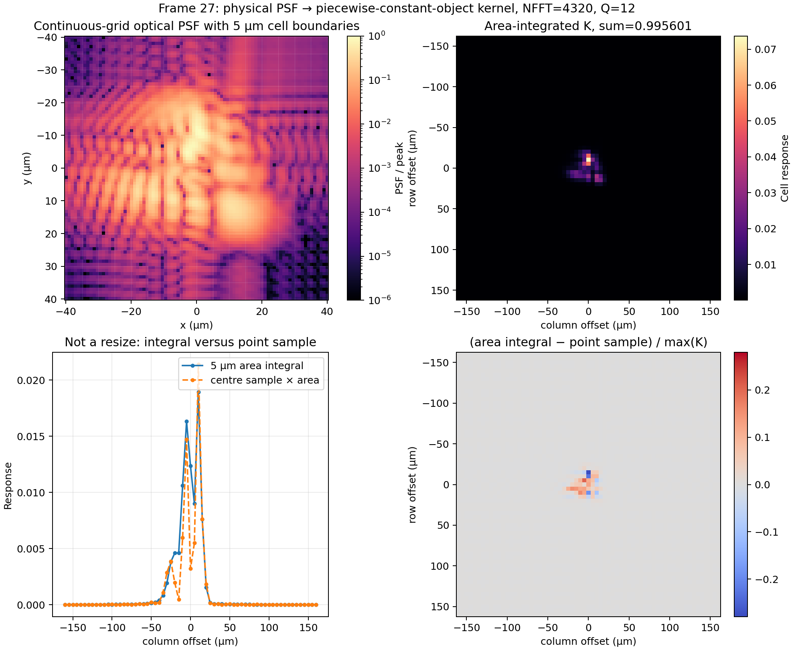
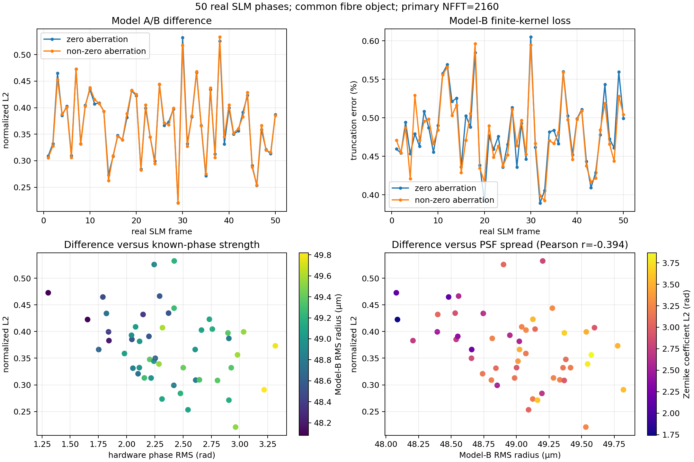
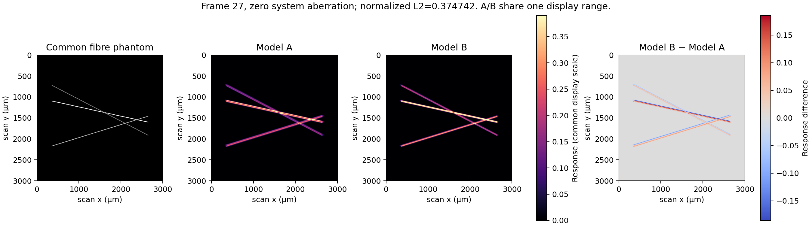
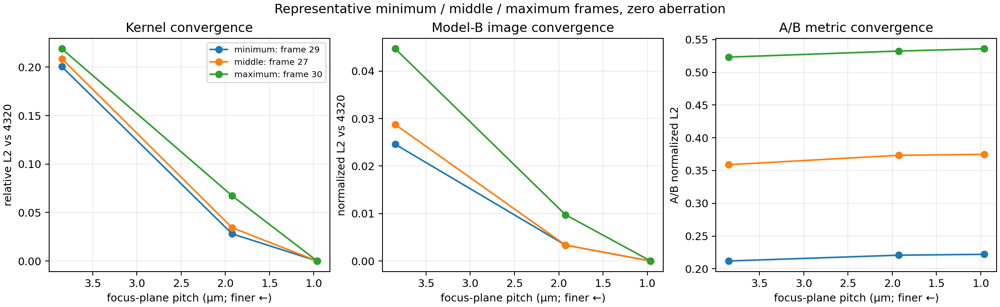

# OR-PAM 模型 B 验证与模型 A/B 系统性对比

本报告由 `tools/validate_orpam_model_b.py` 使用实验对应的 50 张真实 SLM 相位生成。原始实验
数据、大尺寸 PSF 和 NPZ 未纳入 Git；仓库只保存本报告、小体积 PNG、CSV 和 JSON 摘要。

## 1. 模型、物理参数和比较约定

模型 B 使用 1080×1080 硬件相位、6.4 µm SLM 像元、532 nm 波长、50 mm 焦距和方形均匀
瞳。复瞳为

`P_i(u,v) = exp(+i Phi(u,v)) exp(-i Gamma_i(u,v))`。

焦平面采样为 `dx = lambda*f/(N_fft*p)`，PSF 按 `sum(h)*dx^2=1` 做物理面积归一化。
5 µm 分块常数物体产生

`K[k,l] = integral_[-Delta/2,Delta/2]^2 h(k*Delta+u,l*Delta+v) du dv`。

最终 `I[p,q] = sum O[p+k,q+l]K[k,l]` 由 PyTorch `conv2d` 直接作互相关，不翻转模型 B
核。有限核不重新归一化，物体外为零延拓。

主 50 帧统计使用 NFFT=2160、焦平面步长
1.9242 µm、65 核和
12 阶 Gauss–Legendre 求积。模型 A/B 都固定为均匀瞳振幅，
使用同一人工纤维物体；没有把 `StaticDiffuseNet` 的自由振幅表示混入比较。

非零像差明确设为：

`Phi = 0.45(x^2+y^2) + 0.35(x^2-y^2) + 0.30*x*(x^2+y^2)` rad，

其中 `x,y=(index-(N-1)/2)/(N/2)`，分别在 600 和 1080 网格求值。

归一化 L2 指标严格定义为

`D(A,B) = ||A/||A||_2 - B/||B||_2||_2`。

不拟合增益或偏置。它衡量两张预测图的形状差异，**不能解释为模型 B 准确度提升的百分比**。

## 2. 物理与数值正确性

4320 FFT 的理想方孔焦斑实测 FWHM 为 3.3987 µm，理论 sinc²
FWHM 为 3.4093 µm。非零像差 Strehl 比为
0.9162。专项测试还验证了面积归一化、补零收敛、区域积分和
600×600 输出。端到端梯度测试贯穿“相位→PSF→等效核→扫描图像”，float64 中央有限差分
步长为 `1e-5`，判据为 `rtol=3e-4, atol=2e-7`。

人为正向相位倾斜测试得到：`exp(+i Phi)` 使 PSF 和 K 向 +x 移动，固定单点物体的扫描峰向
-x 移动；`exp(-i Gamma)` 的已知相位产生相反移动。这与点扫描式 `S(p)=h(-p)` 一致，证明
模型 B 不应额外翻核。

模型 A 和 B 的张量轴均按 row=`y`、column=`x` 比较；模型 A 保留其原实现的“PSF 先翻转、
再做 legacy FFT convolution”，模型 B 则把 `K` 直接交给 `conv2d`。因此下列 A/B 图像处于
同一数组方向，而不是通过事后翻转配准。

上图直接比较 5 µm 面积积分与“中心点采样×面积”。二者并不等价，等效核不是 PSF resize。

## 3. 50 帧 A/B 统计

| 条件 | 平均值 | 中位数 | 最小值（帧） | 最大值（帧） |
| --- | ---: | ---: | ---: | ---: |
| 零像差 | 0.369779 | 0.369778 | 0.220771（29） | 0.532468（30） |
| 固定非零像差 | 0.369914 | 0.369637 | 0.220028（29） | 0.533183（38） |

模型 B 的逐帧光学与核统计如下；“尺寸”采用整个物理焦平面上的强度 RMS 半径，逐帧原始值和
二维质心均保存在 CSV 中。

| 条件 | PSF 峰值均值 (m^-2) | RMS 半径均值 (µm) | row 质心范围 (µm) | column 质心范围 (µm) | 核保留能量均值 | 截断误差均值 |
| --- | ---: | ---: | ---: | ---: | ---: | ---: |
| 零像差 | 9.07792e+09 | 49.0049 | -1.210…1.432 | -1.593…1.534 | 0.995184 | 0.4816% |
| 固定非零像差 | 8.86506e+09 | 49.0025 | -1.210…1.432 | -1.104…2.023 | 0.995201 | 0.4799% |

零像差条件下，差异与硬件相位 RMS 的 Pearson 相关为
-0.3512，与模型 B PSF RMS 半径的 Pearson 相关为
-0.3939。相关不等于因果；相位强度、焦斑扩展、旧模型
无物理坐标以及区域积分共同变化。

## 4. 受控因素分解

代表帧为最小差异帧 29、中间帧 27、最大差异帧
30。中间帧的受控阶梯结果：

| 改变 | 归一化 L2 | 可归因范围 |
| --- | ---: | --- |
| 原模型 A → 600 网格物理 FFT + 点采样 | 0.380541 | 物理坐标映射与重新采样共同影响，不能再拆开 |
| 600 网格点采样 → 600 网格面积积分 | 0.123769 | 5 µm 物体基函数/区域积分 |
| 600 网格面积积分 → 1080 网格面积积分 | 0.000991 | 同系数相位的 SLM 网格采样；仍含有限采样/视场差异 |
| 1080 网格点采样 → 面积积分 | 0.123333 | 5 µm 区域积分 |
| 正确核 → 错误翻核 | 0.150713 | 纯方向错误 |

有限核重新归一化后，归一化图像指标变化仅
2.407e-07，但原始幅度相对变化为
0.004418；因此逐图归一化会掩盖真实截断能量。
全图 A/B 差异为 0.374742，去除宽度等于核半径的边缘后为
0.374742，量化了零延拓边界的影响。

A/B 图使用完全相同的显示范围，差异图使用对称色标，没有逐图独立拉伸。

## 5. 代表帧采样收敛

三帧均比较 1080、2160 和 4320 FFT；4320 作为本报告的代表帧参考，而不是宣称绝对真值。
没有对 50 帧强行执行 8640 FFT。既有单帧检查显示 4320 与 8640 等效核仍有约 0.7% 相对
差异，因此训练接入前应继续对少量代表帧抽查。

## 6. 已确认结论

- 模型 B 的物理坐标、面积归一化、5 µm 区域积分和互相关方向自洽且可微。
- 真实 50 帧硬件相位、模型相位和实验图像编号逐项匹配；未 resize 或重生成历史相位。
- 50 张硬件 MAT/PNG 的最大圆周相位误差为
  4.845e-05 rad，符合 uint16 包裹相位量化。
- A/B 差异不是单一因素造成。旧模型缺少物理焦面坐标，因此“旧离散 FFT”和“物理尺度”
  无法在输出层完全正交分离。
- 统一振幅后差异仍显著，说明不能把差异归因于 `StaticDiffuseNet` 的自由振幅能力。
- 核重归一化会隐藏截断幅度误差，故模型 B 保留实际核和。

## 7. 尚未确认与下一阶段建议

- MAT 表示设计相位，硬件 PNG 未应用器件 LUT；实际调制相位仍需实验标定。
- 绝对相位符号和实验图像朝向已与软件约定一致，但仍建议用已知倾斜靶做硬件闭环确认。
- 方形均匀瞳尚未包含实际近圆形光束、振幅非均匀、SLM 像元填充因子、1 m 传播和声学响应。
- 亚 5 µm 碳纤维与扫描区外吸收会造成分块常数和零边界失配。
- 接入 NeuWS 时应新增可选 forward backend，不改对象网络；逐帧/小 batch 生成 K，记录每帧
  截断能量，并先做冻结物体或冻结像差的短实验。不要用训练 Loss 单独判定物理正确性。

## 8. 可复现数据

- [50 帧逐项指标](data/orpam_model_b_validation/frame_metrics.csv)
- [代表帧收敛](data/orpam_model_b_validation/convergence_metrics.csv)
- [因素分解](data/orpam_model_b_validation/factor_decomposition.csv)
- [机器可读摘要](data/orpam_model_b_validation/summary.json)
