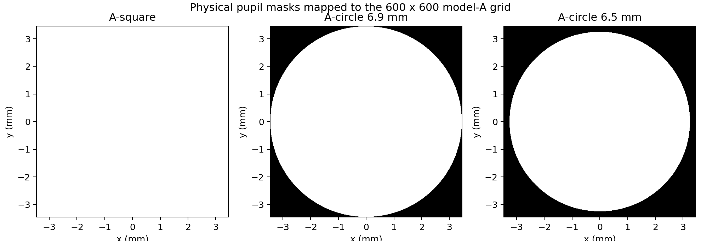
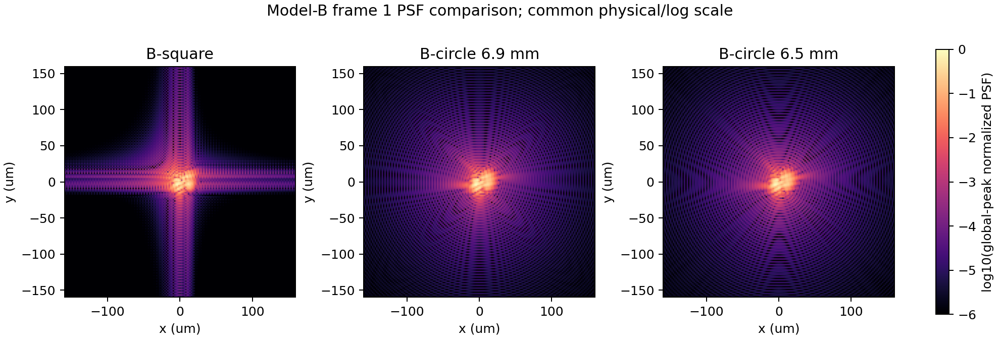
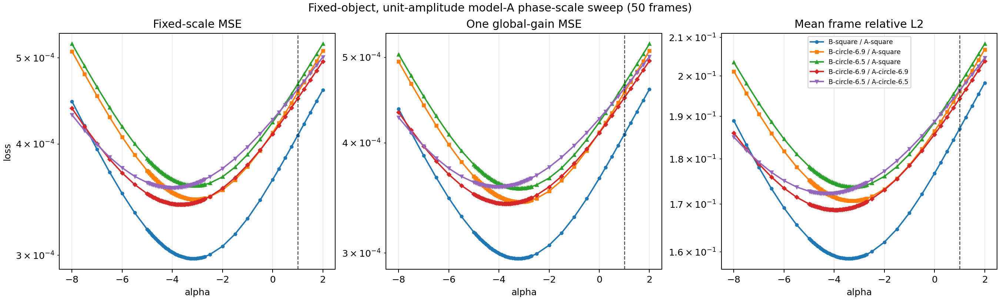

# OR-PAM 圆形瞳孔与固定像差尺度 Loss 扫描

本实验只研究两件事：给物理前向模型 B 增加均匀硬边圆孔，以及在物体、瞳内振幅和
50 张已知 SLM 相位全部固定时，用原模型 A 的前向公式扫描
`Phi_alpha = alpha * Phi_true`。实验没有训练网络、没有优化任何权重，也没有改变
NeuWS 的 `zernike_features=28` 或正式训练流程。

## 1. 数据和相位约定

三组观测使用同一份 `600x600` 血管代理物体、同一固定像差和同一组 50 张真实硬件
SLM 相位：

- B-square：复用 `outputs/orpam_b_to_a/dataset_nfft2160`，没有覆盖或重新生成；
- B-circle-6.9mm：独立生成到
  `outputs/orpam_pupil_mask_loss_sweep/b_circle_6p9mm_nfft2160`；
- B-circle-6.5mm：独立生成到
  `outputs/orpam_pupil_mask_loss_sweep/b_circle_6p5mm_nfft2160`。

程序逐字节核对三个目录中的 `object_true_normalized.npy` 和 `phi_true_600.npy`，并逐值核对
50 个 `SLM_simN.mat:proj_sim`。物体、真值和相位集合的 SHA-256 分别为
`cae347bdd847...`、`75f333bc5d11...` 和 `5c6d20da4bdf...`。没有重新裁剪、增强或逐帧
归一化观测。

固定像差仍为

```text
Phi_true = 0.45*(x^2+y^2) + 0.35*(x^2-y^2) + 0.30*x*(x^2+y^2)
```

所有模型均保持

```text
P_i = exp(+i * alpha * Phi_true) * exp(-i * Gamma_i)
```

其中 `alpha=1` 是生成观测时的真值尺度。这里不通过符号选择、图像配准、逐帧增益或
逐帧 min-max 改变评价结果。

## 2. 圆孔模型 B

`ORPAMModelBConfig` 新增 `pupil_shape` 和 `pupil_diameter_m`。默认值仍是 `square`；只有
选择 `circle` 时，才在 `1080x1080` SLM 物理网格上按像元中心坐标生成二值掩膜：

```text
x[j] = (j - 1079/2) * 6.4 um
M[y,x] = 1,  x^2+y^2 <= (D/2)^2
           0,  otherwise
```

圆心位于偶数网格中央四个像元之间。掩膜先乘到复瞳，再做中心补零和 FFT；它没有乘到
焦平面 PSF、等效核或物体图像上。圆内振幅为一，圆外为零，没有高斯包络、填充因子或
边缘软化。

两组圆孔数据均采用波长 `532 nm`、焦距 `50 mm`、SLM 像元间距 `6.4 um`、
`NFFT=2160`、`5 um` 扫描步长、`12x12` Gauss-Legendre 区域积分和半径 32 的等效核。
CPU 在 `torch.no_grad()` 下逐帧生成。具体诊断如下：

| 圆孔直径 | 有效 SLM 像元数 | 像元面积和 | 50 帧生成时间 | 核保留能量均值 | 范围 |
|---:|---:|---:|---:|---:|---:|
| 6.9 mm | 912932 | `3.73937e-5 m^2` | 42.57 s | 0.995593 | 0.994611–0.996179 |
| 6.5 mm | 810164 | `3.31843e-5 m^2` | 38.17 s | 0.995289 | 0.994211–0.995935 |

模型 B 仍把每帧 PSF 归一化为 `sum(h)*dx_focus^2=1`。因此本实验比较的是孔径形状引起的
PSF 和像差敏感性变化，没有模拟较小圆孔截取入射光后导致的绝对光功率下降。



第 1 帧 PSF 使用统一物理坐标、统一全局峰值和统一对数色标显示。圆孔改变了远离中心的
衍射结构；它不是对最终图像或方孔 PSF 的后处理裁切。



## 3. 模型 A 诊断前向和 Loss

A-square 严格复现 `StaticDiffuseNet.forward` 的原始链路：分别构造未知相位与已知相位的
复指数、相乘、做 `600x600` 的 `fft2(norm="forward")` 和 `fftshift`、取模平方、按离散
像素和归一化、沿两个 PSF 轴翻转，再调用原有双倍补零 FFT 卷积。回归测试把该独立函数
与替换为固定估计量的 `StaticDiffuseNet` 逐元素比较，结果完全相同。

A-circle 只在上述 FFT 之前增加与物理直径对应的 `600x600` 圆形振幅掩膜。它没有引入
模型 B 的焦平面物理坐标、5 um 区域积分或互相关核，所以只是孔径形状控制实验，不是新的
正式 NeuWS 模型。

对每个 `alpha` 和每条曲线，预测和观测均包含全部 `50x600x600` 像素。三个指标定义为：

```text
raw_mse = mean((A_prediction - B_observation)^2)
g(alpha) = <A_prediction, B_observation> / <A_prediction, A_prediction>
gain_mse = mean((g(alpha)*A_prediction - B_observation)^2)
relative_l2 = mean_i ||A_i-B_i||_2 / ||B_i||_2
```

`g(alpha)` 是每条曲线、每个 `alpha` 对全部 50 帧共同拟合的唯一标量；没有偏置，也没有
逐帧增益。先扫描任务指定的 `[-1, 2]` 点，因所有最低点落在左边界而扩展到 `[-8, 2]`，
随后在相关最低点区域以 0.05 步长细扫。最终共记录 67 个 `alpha`，三项指标的最低点均不在
最终扫描边界。

## 4. 50 帧扫描结果

| 观测 / 预测 | 指标 | `alpha_best` | 最低 Loss | Loss(`alpha=1`) | `Loss(1)-Loss_min` |
|---|---|---:|---:|---:|---:|
| B-square / A-square | 固定尺度 MSE | -3.15 | 2.97418e-4 | 4.08996e-4 | 1.11578e-4 |
|  | 全局增益 MSE | -3.25 | 2.95714e-4 | 4.08984e-4 | 1.13271e-4 |
|  | 平均相对 L2 | -3.40 | 0.158656 | 0.187057 | 0.028402 |
| B-circle-6.9 / A-square | 固定尺度 MSE | -3.10 | 3.46642e-4 | 4.56854e-4 | 1.10212e-4 |
|  | 全局增益 MSE | -3.15 | 3.42811e-4 | 4.56237e-4 | 1.13426e-4 |
|  | 平均相对 L2 | -3.30 | 0.170711 | 0.196101 | 0.025390 |
| B-circle-6.9 / A-circle-6.9 | 固定尺度 MSE | -3.65 | 3.42036e-4 | 4.49950e-4 | 1.07915e-4 |
|  | 全局增益 MSE | -3.70 | 3.41226e-4 | 4.49915e-4 | 1.08689e-4 |
|  | 平均相对 L2 | -3.95 | 0.168756 | 0.194338 | 0.025583 |
| B-circle-6.5 / A-square | 固定尺度 MSE | -3.10 | 3.59093e-4 | 4.67025e-4 | 1.07932e-4 |
|  | 全局增益 MSE | -3.20 | 3.55136e-4 | 4.66346e-4 | 1.11210e-4 |
|  | 平均相对 L2 | -3.25 | 0.173749 | 0.197876 | 0.024127 |
| B-circle-6.5 / A-circle-6.5 | 固定尺度 MSE | -4.00 | 3.57286e-4 | 4.61038e-4 | 1.03752e-4 |
|  | 全局增益 MSE | -4.05 | 3.56688e-4 | 4.60947e-4 | 1.04260e-4 |
|  | 平均相对 L2 | -4.30 | 0.172296 | 0.196342 | 0.024045 |



### 核心判断

1. `alpha=1` 不是五组曲线中任何一个指标的最低点。即使 B-square/A-square 的孔径形状
   已匹配，固定尺度 MSE 仍在 `alpha=-3.15` 最低，因此圆孔不可能是已有偏差的唯一来源。
2. 把 6.9 mm 圆孔同时用于 B 和 A 后，固定尺度最低点从 A-square 控制下的 `-3.10`
   移到 `-3.65`；6.5 mm 时从 `-3.10` 移到 `-4.00`。匹配圆孔没有使最低点接近 1。
3. 圆孔直径从 6.9 mm 改成 6.5 mm 对 A-square 的固定尺度最低点没有可分辨变化
   （均为 `-3.10`），但对匹配 A-circle 的最低点有明显变化（`-3.65` 到 `-4.00`）。
4. 允许一个全局增益只小幅降低 MSE，且最低点与固定尺度 MSE 相近；负向最低点不是由
   简单的整体亮度比例造成的。
5. 已匹配孔径后仍保留的失配包括：A 的 600 网格离散 FFT 与 B 的 1080 瞳面/2160
   焦面采样差异、B 的 5 um 分块区域积分、A 的 PSF 翻转和 FFT 卷积约定、B 的互相关
   核方向、两者有限支持及边界处理差异。当前一维扫描没有逐项关闭这些差异，所以不能把
   负向最低点唯一归因于其中某一项，也不能直接把它解释为硬件相位符号错误。

这些结论只适用于已知固定物体、均匀瞳内振幅和单一真值相位尺度方向。它们不能证明或否定
28 阶、物体和自由振幅共同参与时的完整联合反演可辨识性；本实验也没有实施用户此前建议的
8 项 Zernike 受控训练。

## 5. 结果文件和复现

提交到 Git 的小体积结果：

- [完整 67 点 CSV](data/orpam_pupil_mask_loss_sweep/loss_sweep.csv)
- [结构化摘要 JSON](data/orpam_pupil_mask_loss_sweep/summary.json)
- [Loss 曲线](figures/orpam_pupil_mask_loss_sweep/loss_sweep.png)
- [瞳孔掩膜](figures/orpam_pupil_mask_loss_sweep/pupil_mask_comparison.png)
- [PSF 对比](figures/orpam_pupil_mask_loss_sweep/psf_comparison.png)

完整的 50 帧圆孔观测、掩膜数组、PSF 诊断和中间扫描保留在本地
`outputs/orpam_pupil_mask_loss_sweep/`，未提交到 Git。

生成两个圆孔数据集：

```bash
python tools/orpam_pupil_mask_loss_sweep.py generate-circle \
  --base-data-dir outputs/orpam_b_to_a/dataset_nfft2160 \
  --output-dir outputs/orpam_pupil_mask_loss_sweep/b_circle_6p9mm_nfft2160 \
  --pupil-diameter-mm 6.9 --fft-size 2160 --kernel-radius 32 \
  --quadrature-order 12 --num-frames 50

python tools/orpam_pupil_mask_loss_sweep.py generate-circle \
  --base-data-dir outputs/orpam_b_to_a/dataset_nfft2160 \
  --output-dir outputs/orpam_pupil_mask_loss_sweep/b_circle_6p5mm_nfft2160 \
  --pupil-diameter-mm 6.5 --fft-size 2160 --kernel-radius 32 \
  --quadrature-order 12 --num-frames 50
```

扫描入口如下；默认只跑任务指定的 11 个粗点，本文结果通过 `--alphas` 额外传入报告 JSON
列出的 67 点：

```bash
python tools/orpam_pupil_mask_loss_sweep.py sweep \
  --square-data-dir outputs/orpam_b_to_a/dataset_nfft2160 \
  --circle-69-data-dir outputs/orpam_pupil_mask_loss_sweep/b_circle_6p9mm_nfft2160 \
  --circle-65-data-dir outputs/orpam_pupil_mask_loss_sweep/b_circle_6p5mm_nfft2160 \
  --output-dir outputs/orpam_pupil_mask_loss_sweep/final_results \
  --num-frames 50 --batch-size 10 --device cuda --fft-size 2160
```

## 6. 测试范围

新增测试覆盖：默认方孔与旧模型 B 逐元素一致；两个物理圆孔的中心对称性、直径和面积；
圆孔 PSF 有限且物理面积积分为一；A-square 与原 `StaticDiffuseNet` 前向逐元素一致；
A-circle 只在 FFT 前增加掩膜；五条曲线使用相同物体、相位编号和 600 网格物理直径。

```bash
python -m pytest -q tests/test_orpam_model_b.py \
  tests/test_orpam_pupil_mask_loss_sweep.py tests/test_orpam_b_to_a_experiment.py
# 24 passed

python -m pytest -q
# 151 passed, 2 skipped
```

警告来自 AOtools/NumPy、scikit-image 和 CuPy 的既有弃用或实验接口提示，本次没有新增测试
失败。
