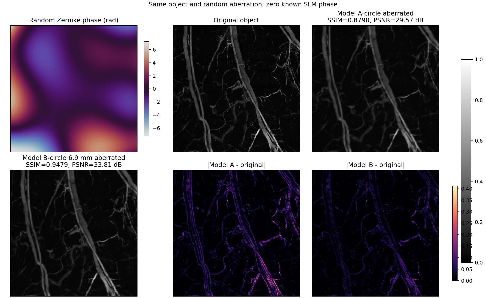
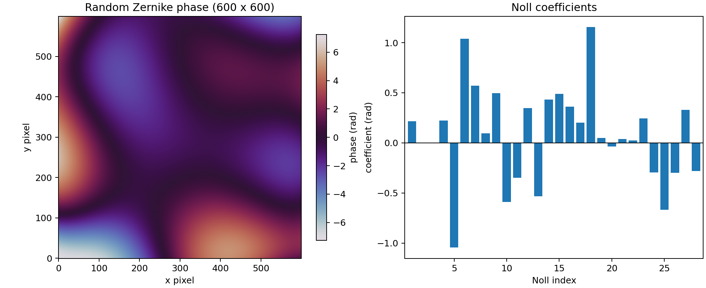
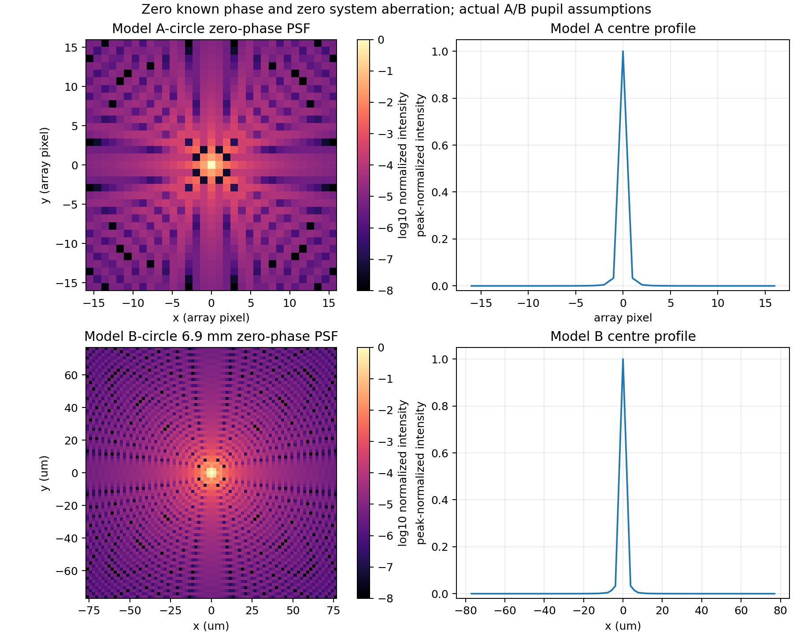

# 随机 Zernike 像差：A-circle / B-circle 受控前向比较

本结果使用同一组随机 Zernike 系数、同一 6.9 mm 均匀硬边圆孔、同一血管代理物体和零
已知 SLM 相位，对模型 A 与模型 B 做受控前向比较。没有训练或优化网络。

## 设置

- 随机种子：`20261028`；
- Zernike：Noll 4–28 随机，Noll 2、3 tip/tilt 固定为零，piston 调整为零均值；
- 600 网格名义相位 RMS：`2.000000 rad`，峰谷值：`14.3671 rad`；
- A：原 NeuWS 数学链路，只在 FFT 前增加映射到 600 网格的 6.9 mm 圆孔；
- B：1080 瞳面上的 6.9 mm 圆孔，`NFFT=2160`、核半径 32、12 阶区域积分；
- 指标：模拟图与原物体按固定原始尺度比较，没有增益拟合或输出归一化。

两边实际进入圆孔的相位 RMS 几乎一致：A 为 `1.673925 rad`，B 为 `1.669080 rad`。

## 图像结果



| 模型 | SSIM | PSNR | MSE | 相对 L2 |
|---|---:|---:|---:|---:|
| A-circle | 0.879036 | 29.5651 dB | 1.10532e-3 | 0.286601 |
| B-circle | 0.947945 | 33.8051 dB | 4.16383e-4 | 0.175906 |

单独的固定显示范围 PNG：

- [原物体](object_original.png)
- [A-circle 前向图像](model_a_aberrated_image.png)
- [B-circle 前向图像](model_b_aberrated_image.png)

随机相位和具体系数：



## 空相位 PSF

空相位表示已知 SLM 相位和系统像差均为零，只保留相同的 6.9 mm 圆孔。



A 仍使用 600 点离散 FFT，并把 PSF 数组下标直接当成 5 um 扫描网格下标。B 先以
`1.92419 um` 的焦面间距计算 PSF，再对每个 5 um 物体单元做区域积分。

## 核宽度

| 包含能量 | A-circle 半径 | B-circle 半径 | A/B |
|---:|---:|---:|---:|
| 50% | 1.9301 像素 | 1.6492 像素 | 1.17 |
| 80% | 3.4956 像素 | 2.8841 像素 | 1.21 |
| 90% | 4.8385 像素 | 3.8274 像素 | 1.26 |
| 95% | 6.3132 像素 | 4.8709 像素 | 1.30 |
| 99% | 20.6499 像素 | 11.4173 像素 | 1.81 |

相同口径的天然焦面间距约为 `lambda*f/D = 3.86 um`。A 把这一 FFT 采样直接对应到
5 um 物体像素，预期宽度比例为 `5/3.86 = 1.30`；实际 95% 能量半径比例同样为 1.30。
因此，在圆孔和有效相位 RMS 已匹配后，中心核宽度差异主要来自 A 的 FFT 像素与扫描像素
直接绑定。99% 半径还受到粗瞳面采样、远端衍射尾部、A 的完整 600 核以及 B 的有限核支持
影响。B 的核截断能量约为 `0.441%`，不能单独解释中心 50%–95% 能量半径差异。

## 数值文件

- [完整参数和指标](summary.json)
- [Zernike 系数](zernike_coefficients.csv)
- [图像指标](image_metrics.csv)
- [核能量半径](kernel_energy_radii.csv)

完整浮点 TIFF、NPY、完整 PSF NPZ 和等效核保留在本地
`outputs/orpam_random_zernike_ab_demo_seed20261028_rms2p0_matched_circle6p9/`，没有提交。

## 复现

```bash
python tools/orpam_random_zernike_ab_demo.py \
  --output-dir outputs/orpam_random_zernike_ab_demo_seed20261028_rms2p0_matched_circle6p9 \
  --seed 20261028 --num-modes 28 --phase-rms-rad 2.0 \
  --a-pupil circle --b-pupil-diameter-mm 6.9 \
  --fft-size 2160 --kernel-radius 32 --quadrature-order 12 --device cpu
```
